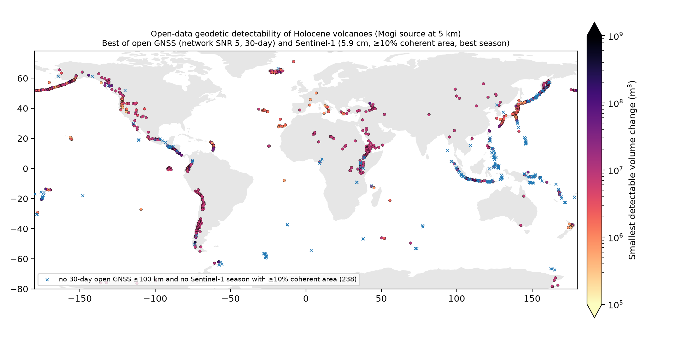
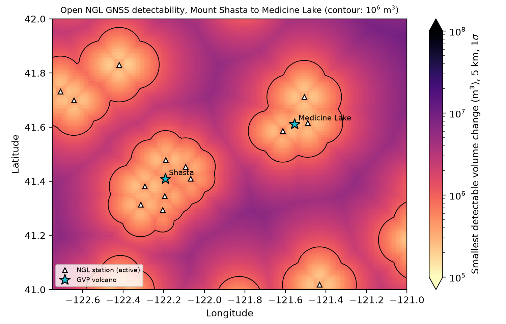

# Volcano geodetic detectability (open data)

[](https://doi.org/10.5281/zenodo.24308318)

How much magma can collect beneath each of the world's Holocene volcanoes before open geodetic data would notice?
For every Smithsonian GVP Holocene volcano this repository computes the smallest volume change of a source at 2, 5 and
10 km depth that open GNSS (Nevada Geodetic Laboratory, NGL) and open Sentinel-1 coherence would detect.

**Interactive globe:** https://ismoilovdevml.github.io/volcano-detectability/atlas/


> Work in progress (revised after two internal reviews, 2026-11-17; see docs/review-responses.md). This measures what
> **open** data can see, not what volcano observatories see: many national networks are not in NGL.

## Criteria

- **GNSS (main):** a matched filter over all open NGL stations within 100 km detects the source at signal-to-noise 5
  when two 30-day mean positions are compared (noise per station and component, seasonal motion and velocity removed;
  displacement noise = sqrt(2) x 30-day noise). False-alarm probability about 3e-7 per test.
- **GNSS (first pass, for comparison with USGS):** 1 sigma daily noise exceeded on one component of one station
  (USGS SIR 2024-5062-D, SIR 2026-5117-A). It has no false-alarm control.
- **Sentinel-1:** line-of-sight uplift of 5.9 cm (Biggs et al. 2022) at a coherent pixel near the summit, counted only
  in seasons when at least 10 % of the pixels within 5 km are coherent (Kellndorfer et al. 2022 seasonal coherence).

## Results (Mogi source at 5 km, 1,100 subaerial volcanoes)

| | Main criteria | First pass |
|---|---|---|
| Active NGL stations used | 2,480 | 2,480 |
| No open GNSS station within 100 km | 501 | 483 |
| GNSS detects 1e6 / 1e7 m3 | 70 / 286 | 173 / 376 |
| Sentinel-1 detects 1e7 m3, best / worst season | 602 / 276 | 849 / 470 (single pixel) |
| Sentinel-1 floor at 5 km | 7.95e6 m3 | 7.95e6 m3 |
| GNSS or Sentinel-1 detects 1e7 m3 (best season) | 729 | 920 |

Threat, exposure and blindness (`scripts/ranking.py`; GVP population within 30 km and eruption list):

- 380 volcanoes had a confirmed eruption starting in 1900 or later; 118 of them have at least 100,000 people within
  30 km ("active and exposed").
- Open GNSS cannot detect 1e7 m3 at 75 of the 118 (64 %, 95 % CI 55-72); 58-79 M people live within 30 km of them
  (lower bound: volcanoes more than 60 km apart; upper bound: sum over volcanoes). Neither GNSS nor Sentinel-1 in its
  worst season detects 1e7 m3 at 53 (45 %, CI 36-54; 48-62 M people).
- Coverage follows people within countries and data policy between countries. Stratified by country, active and
  exposed volcanoes are much better covered than the rest (Mantel-Haenszel odds ratio of being blind 0.05,
  p < 1e-4); population drives this (OR 0.06), eruption frequency does not (OR 0.98, p = 0.99). Pooled over the world
  the difference is small (64 % against 75 %, Fisher p = 0.008) and vanishes without Japan (77 % against 80 %,
  p = 0.51), whose 21 active and exposed volcanoes are all covered.
- Most of the 75 are in Indonesia (39 volcanoes, 45 M people by sum), Mexico, the Philippines and Central America.
- Source model (`scripts/source_sensitivity.py`): a source 5 km off the summit gives 76-78 of 118; a horizontal sill
  (Okada point source, signal decays as R^-5) gives 93 of 118. The Mogi numbers are the optimistic case.
- National networks (`docs/data/national_networks.csv`, GVMID + literature): of the 75, 21 have documented continuous
  observatory GNSS whose data are not open, 17 had open sites that are no longer active, 5 only campaign GPS, 2 tilt
  or levelling only, and 30 have no ground deformation network found (upper bound; Indonesian reports not searched
  volcano by volcano; 5 volcanoes new in the revision are classified from GVMID only). Items tagged `search-summary`
  must be read in full before citation.
- Two of the 75 are volcanic fields (Michoacan-Guanajuato, Hainan) where a point source below one coordinate is only
  indicative; without them 73 of 116.
- Benchmark (first-pass criterion, as USGS): the USGS Mount Shasta to Medicine Lake pattern is reproduced (2-5e5 m3 at
  the edifices, about 2e6 m3 between them).





## Run

```bash
uv venv --python 3.12 .venv && uv pip install --python .venv/bin/python -r requirements.txt
.venv/bin/python -I -m unittest discover -s tests -v
curl -o data/raw/gvp_holocene.json "https://webservices.volcano.si.edu/geoserver/GVP-VOTW/ows?service=WFS&version=1.0.0&request=GetFeature&typeName=GVP-VOTW:Smithsonian_VOTW_Holocene_Volcanoes&outputFormat=application/json"
curl -o data/raw/DataHoldings.txt https://geodesy.unr.edu/NGLStationPages/DataHoldings.txt
.venv/bin/python scripts/station_noise.py      # ~250 kB per station via HTTP Range, resumable
.venv/bin/python scripts/detectability.py
.venv/bin/python scripts/benchmark_usgs.py
.venv/bin/python scripts/insar_coherence.py    # windowed reads of the public coherence COGs
.venv/bin/python scripts/combine.py
.venv/bin/python scripts/ranking.py
.venv/bin/python scripts/source_sensitivity.py
.venv/bin/python scripts/national_networks/fetch_gvmid.py && .venv/bin/python scripts/national_networks/classify.py data/raw/gvmid data/raw/gvmid/classified.json && .venv/bin/python scripts/national_networks/build.py data/raw/gvmid docs/data/national_networks.csv docs/data/station_noise.csv
.venv/bin/python scripts/export_web.py        # data for docs/atlas (MapLibre globe)
```

Method, assumptions and limitations: [docs/method.md](docs/method.md). Corrections: [docs/corrections.md](docs/corrections.md). Prior work and what is new:
[docs/prior-work.md](docs/prior-work.md).

## Data and licences

Inputs: GVP Volcanoes of the World (Smithsonian; terms of use page could not be read automatically, treated as
non-commercial), NGL GNSS (Blewitt, Hammond & Kreemer 2018, Eos 99), Sentinel-1 global seasonal coherence (Kellndorfer
et al. 2022, AWS open data), GVMID (Widiwijayanti et al. 2024; WOVOdat data policy: free non-commercial research use, cite the data owners, no
redistribution; this repository publishes only per-volcano counts and classes derived from it, not station lists), Natural Earth.
Licences of this repository: code MIT; the values computed here (detectable volumes, noise estimates, coherence
summaries, rankings, keyed by GVP volcano number and NGL site) CC BY 4.0. Columns copied from GVP (names, coordinates,
population, eruptions) remain under GVP's terms; GVMID-derived counts are credited to the contributing observatories.

## How to cite

Ismoilov, O. (2026). volcano-detectability: open-data geodetic detectability of Holocene volcanoes (GNSS,
Sentinel-1), version 1.0.0. Zenodo. https://doi.org/10.5281/zenodo.24308319
