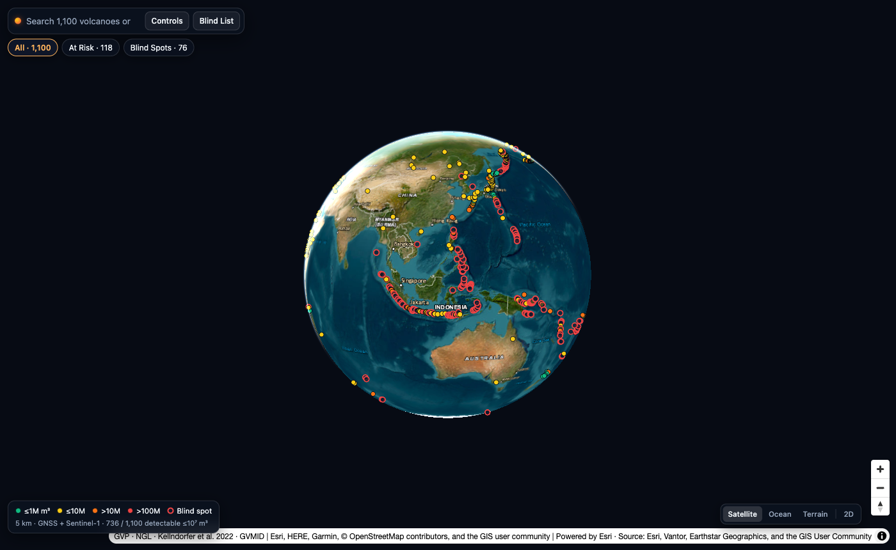

# Volcano geodetic detectability (open data)

How much magma can collect beneath each of the world's Holocene volcanoes before open GNSS data would notice?
For every Smithsonian GVP Holocene volcano, this repository computes the smallest Mogi volume change at 2, 5 and 10 km
depth that would exceed the daily white noise of at least one open Nevada Geodetic Laboratory (NGL) GNSS station on
at least one component. The criterion follows USGS SIR 2024-5062-D and SIR 2026-5117-A, applied globally.

**Interactive globe:** https://ismoilovdevml.github.io/volcano-detectability/atlas/



> Work in progress (first pass, 2026-11-17). This measures what **open** data can see, not what volcano observatories
> see: many national networks are not in NGL.

## First numbers (5 km depth, 1 sigma, daily noise)

- 1,100 GVP Holocene volcanoes at or above sea level; 2,477 active NGL stations within 100 km of one.
- 484 have no active open station within 100 km.
- A 1e6 m3 change is detectable at 173; a 1e7 m3 change at 376. With the noise of 30-day means instead of daily
  noise (coloured noise included): 193 and 406, so the picture does not depend on the averaging window.
- Of 383 that erupted since 1900, 256 cannot detect 1e7 m3 and 171 have no station within 100 km.
- Benchmark: the USGS Mount Shasta to Medicine Lake map is reproduced in pattern (2-5e5 m3 at the edifices, about
  2e6 m3 between them; USGS reports more than 1e6 m3 could go undetected there).

Sentinel-1 layer (global seasonal 12-day coherence, Kellndorfer et al. 2022; LOS threshold 5.9 cm after Biggs et al.
2022, or 1 cm for careful time series; best and worst season):

- With 5.9 cm, a 1e7 m3 change at 5 km is visible at 849 volcanoes in their best season but only 470 in their worst
  (snow, vegetation); 95 have no coherent pixel within 20 km in any season.
- Sentinel-1 never reaches 1e6 m3 at 5 km; below about 6e6 m3 only GNSS can see.
- GNSS or Sentinel-1 combined: 920 of 1,100 can see 1e7 m3; 69 see nothing (mostly remote ocean islands).

Threat x blindness (`scripts/ranking.py`; population within 30 km and eruptions from GVP):

- 380 volcanoes erupted since 1900; 118 of them have at least 100,000 people within 30 km.
- 70 of those 118 (59 %) have no open GNSS station that would see a 1e7 m3 change at 5 km; 72 M people live within
  30 km of them. Most are in Indonesia (36 volcanoes, 40 M people), the Philippines, Mexico and Central America.
- Sentinel-1 sees about 8e6 m3 at best at these volcanoes, so smaller changes are visible only to ground GNSS.
- Source model (`scripts/source_sensitivity.py`): moving the Mogi source 5 km from the summit changes little (70 of
  118 at the median and worst azimuth). A horizontal sill (Okada point source) decays faster with distance, so open
  stations see it worse: 85 of 118 blind, 93 M people. The Mogi numbers are the optimistic case.
- Many of these countries run national GNSS networks that are not in NGL: read this as "not visible in open data".
  A check of the 70 against GVMID (Widiwijayanti et al. 2024) and the literature (`docs/data/national_networks.csv`,
  `scripts/national_networks/`): 20 have documented continuous observatory GNSS whose data are not open (a data-access
  gap), 14 had open GNSS sites that are no longer active, 5 only campaign GPS, and 31 have no ground GNSS found (an
  upper bound; Indonesian observatory reports were not searched volcano by volcano). Evidence items marked
  `search-summary` still need to be read in full before citation.


## Run

```bash
uv venv --python 3.12 .venv && uv pip install --python .venv/bin/python -r requirements.txt
.venv/bin/python -I -m unittest discover -s tests -v
curl -o data/raw/gvp_holocene.json "https://webservices.volcano.si.edu/geoserver/GVP-VOTW/ows?service=WFS&version=1.0.0&request=GetFeature&typeName=GVP-VOTW:Smithsonian_VOTW_Holocene_Volcanoes&outputFormat=application/json"
curl -o data/raw/DataHoldings.txt https://geodesy.unr.edu/NGLStationPages/DataHoldings.txt
.venv/bin/python scripts/station_noise.py      # ~250 kB per station via HTTP Range, resumable
.venv/bin/python scripts/detectability.py
.venv/bin/python scripts/benchmark_usgs.py
.venv/bin/python scripts/insar_coherence.py    # windowed reads of the public coherence COGs
.venv/bin/python scripts/combine.py
.venv/bin/python scripts/ranking.py
.venv/bin/python scripts/source_sensitivity.py
.venv/bin/python scripts/export_web.py        # data for docs/atlas (MapLibre globe)
```

Method, assumptions and limitations: [docs/method.md](docs/method.md). Corrections: [docs/corrections.md](docs/corrections.md). Prior work and what is new:
[docs/prior-work.md](docs/prior-work.md).

## Data and licences

GVP Volcanoes of the World (Smithsonian, non-commercial terms), NGL GNSS (Blewitt, Hammond & Kreemer 2018, Eos 99).
Derived tables: CC BY-NC 4.0 because of the GVP terms. Code: MIT.
